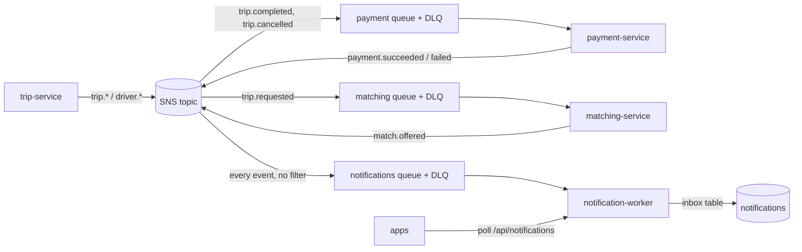

# RideNow Architecture

How RideNow is put together, why, and where it falls short of production.

- Product scope and goals: `RideNow_Project_Proposal.md`.
- Per-service details (ports, APIs, packages): `SERVICES.md`.
- Glossary of techniques: `KNOWLEDGE.md`.
- Persistent fields: `database/ridenow.dbml`.

---

## 1. The guiding idea

> Keep the boundaries fixed. Change only the mechanism behind each boundary.

A boundary is any place where one part of the system talks to another. Every boundary
started with the simplest local mechanism and is swapped for the managed one by
**configuration**, not by rewriting business code:

| Boundary | Local mechanism | Cloud mechanism | Hidden behind |
|---|---|---|---|
| Service-to-service call | HTTP to `localhost` / compose DNS | HTTP to Kubernetes Service DNS | a URL in config + a small client class |
| Domain events | SNS + SQS on LocalStack | Amazon SNS + SQS | `DomainEventPublisher` (logging impl or SNS impl) |
| Durable data | Postgres container per service | RDS PostgreSQL per service | datasource URL |
| Live driver state, GEO, Pub/Sub, streams, cache | Valkey container | ElastiCache for Valkey | Redis-protocol host/port (+ TLS flag) |
| Nearby-driver search | Postgres scan | Redis GEO | `NearbyDriverFinder` |
| Payment provider | `SimulatedPaymentGateway` | a real provider | `PaymentGateway` |
| Delivery to apps | inbox table, read by polling; driver position over SSE | the same; the gateway sits behind the ALB `/live` path | `NotificationSender`, `RoadSnapper` (frontend) |
| Running a service | `mvnw spring-boot:run`, then Docker Compose | EKS on Fargate | image + env vars |
| Secrets | `application.yaml` / `.env` | Secrets Manager via External Secrets + IRSA | env vars |

Test for a healthy boundary: if swapping its mechanism would force a change to business
logic, the boundary has leaked. Fix that before adding anything new.

---

## 2. Services and data ownership

```
                 Rider app                           Driver app
                    |  REST                              |  REST
                    v                                    v
   +--------------+      +--------------+      +----------------+
   | user-service |<-----| driver-svc   |----->| matching-svc   |
   | accounts     | HTTP | drivers,     |stream| offers,        |
   +--------------+      | live state   |      | Redis GEO      |
                         +--------------+      +----------------+
                    REST                            ^ trip.requested
                    v                               | (SQS)
   +-------------------------------+   HTTP   +----------------+
   |        trip-service           |--------->| payment-svc    |
   | lifecycle, @Version accept    | authorize| hold/capture/  |
   +-------------------------------+          | release        |
                    | events                  +----------------+
                    v                                ^ trip.completed /
             SNS topic        --> one SQS queue per consumer --+ trip.cancelled
                    |
                    v
   +-------------------------+  Redis Pub/Sub  +------------------+
   | notification-worker     |---------------->| realtime-gateway |--SSE--------> apps
   | idempotent SQS consumer |                 | holds streams    |
   +-------------------------+                 +------------------+
```

| Service | Owns | Talks to others by |
|---|---|---|
| user-service | users | serves HTTP |
| driver-service | drivers, vehicles; live state in Redis | HTTP to user-service; publishes positions on a Redis channel (the gateway) and appends them to a Redis stream (matching-service) |
| trip-service | trips, trip offers, the accept race | HTTP to payment-service; publishes events |
| payment-service | payments | serves HTTP; consumes its queue; publishes events |
| matching-service | driver positions, offers it makes, the GEO index | consumes its queue and the driver-locations stream; publishes events |
| notification-worker | the processed-notification ledger, the notification inbox | consumes its queue; writes tracking keys to Redis; serves `/api/notifications` |
| realtime-gateway | nothing (no database) | subscribes to Redis; holds SSE streams |

Rules that hold everywhere:

- **Database per service.** No shared tables, no cross-service joins.
- **Access goes through an API or an event,** never through another service's database.
- **Foreign ids are plain UUIDs,** never JPA relationships across services.
- **Ratings ownership is undecided.** No service owns ratings yet.

---

## 3. Sync or async: the rule and the map

**Rule:** if the caller needs the answer to continue, call it synchronously over HTTP.
If something merely *happened* and others react later, publish an event. Most
interactions stay synchronous, and async is added per interaction, not project-wide.

| Interaction | Mode | Why |
|---|---|---|
| User / driver CRUD; driver -> user validation | Sync | the caller needs the result |
| `POST /trips` -> payment **authorize** | **Sync, strict** | a bad card must stop the trip before any driver is bothered |
| `POST /trips` -> find drivers | **Async** (`trip.requested`) | trip creation must not wait on the geo search |
| `accept` | Sync, then event | the optimistic lock needs an immediate winner or loser |
| `arrive`, `start`, `complete`, `cancel` | Sync, then event | the state change is the answer; reactions come later |
| Trip ends -> payment **capture / release** | **Async** (`trip.completed` / `trip.cancelled`) | the rider never waits on it; retries are safe |
| Any event -> tell the user | **Async** | delivery must never slow the business flow |
| Driver location write | Sync write + Redis Pub/Sub + Redis Stream | Redis is the primary store; the gateway may lose updates, matching reads a retained stream with retries |
| Trip / payment reads | Sync | the caller needs the answer |

### 3.1 Event routing



- **One filtered subscription per consumer, matched on the event `type`.** A consumer
  sees only the events it handles (a body-scope filter policy). The notifications
  subscription has no filter and receives everything. Adding a consumer means adding a
  subscription and a queue; publishers do not change.
- **Raw message delivery.** The SQS body is the event JSON itself, so consumers parse it
  directly, with no SNS envelope.
- **Every queue has a DLQ** with `maxReceiveCount` 5. Each queue's policy admits only the
  RideNow topic (`aws:SourceArn`).
- **Events are published after commit** (`@TransactionalEventListener(AFTER_COMMIT)`),
  so a rolled-back change publishes nothing.
- **Every consumer is idempotent,** because SQS delivers at least once. A consumer deletes
  a message only after handling it. A malformed message is dropped, and anything else
  that fails is retried and then dead-lettered.

| Event | Published by | Consumed by |
|---|---|---|
| `trip.requested` | trip-service | matching, notifications |
| `driver.accepted`, `driver.arrived`, `trip.started` | trip-service | notifications |
| `trip.completed`, `trip.cancelled` | trip-service | payment, notifications |
| `match.offered` | matching-service | notifications (to the driver) |
| `payment.succeeded`, `payment.failed` | payment-service | notifications |

### 3.2 Payment: authorize, then capture or release

```
PENDING -> PROCESSING -> AUTHORIZED     sync, inside POST /trips
AUTHORIZED -> PAID                      async, on trip.completed (final fare)
AUTHORIZED -> RELEASED                  async, on trip.cancelled
PROCESSING -> FAILED                    authorize declined
AUTHORIZED -> FAILED                    capture failed (compensation path)
```

- **Strict.** If authorize is declined, trip creation returns `402`. If payment-service is
  slow or down, it returns `503`. Either way no trip row is written.
- **No double hold.** The trip id is the idempotency key, so a retried `POST /trips` cannot
  create a second hold.
- **Compensation.** If the hold may exist but the trip was not saved, trip-service
  publishes a compensating `trip.cancelled`, and payment-service releases the hold. This
  event names no recipient, because the rider already got the error synchronously.
- **Repeats are safe.** Capture and release do nothing on a payment that is already final,
  so a duplicate delivery cannot double-charge.
- **Fare.** trip-service estimates it from straight-line distance times a per-ride-type
  rate plus a base fare. The final fare equals the estimate for now; recomputing it
  from the real route is deferred.
- **Saga case.** A failed capture moves the payment to `FAILED`, publishes
  `payment.failed`, and the rider is notified. There is no cross-service transaction.

### 3.3 Concurrency: exactly one driver wins

- **Where the race lives.** Accept-ride is decided in one service and one database:
  trip-service, with `@Version` optimistic locking. matching-service only proposes
  candidates and never decides who wins.
- **The guarantee.** 50 simultaneous accepts produce exactly one winner, proven by
  `AcceptTripConcurrencyTest`.
- **What's never cached.** Trip status and the accept read. A stale read there would break
  the guarantee.

---

## 4. Messaging and Valkey: one job per tool

| Need | Tool | Not this |
|---|---|---|
| Answer now | HTTP | a queue |
| Do one task later, reliably | SQS (+ DLQ) | Redis Pub/Sub |
| One event, many independent reactors | SNS -> one SQS queue per consumer | EventBridge (an alternative to SNS; we picked one) |
| Real-time, lossy, latest-value-wins stream | Redis Pub/Sub | SQS |
| High-rate updates that one consumer group must not miss (driver positions) | Redis Stream + consumer group | SQS (one message per second per driver is costly), Pub/Sub (drops while a pod is down) |

**Redis Pub/Sub is not a queue.** It is fire-and-forget: a subscriber that is down
misses the message forever, and nothing is stored, retried or dead-lettered. That suits
GPS pings and the last hop to the SSE gateway, because the client resyncs over
REST. It never suits payments or anything that must not be lost.

**A Redis Stream is the middle ground for driver positions.** The matching index must
not miss updates while a pod restarts, but positions are high-rate and each one is
replaced by the next, so SQS is the wrong cost and Pub/Sub the wrong guarantee.
driver-service appends each update to `ridenow:stream:driver-locations` (capped at
about 10,000 entries). matching-service reads it through a consumer group: an entry is
acknowledged after it is applied, retried if the pod dies or fails, and moved to a
dead-letter stream after 5 deliveries. Delivery is at-least-once, so matching ignores
reports that are not newer than what it holds. Domain events that must not be lost
still use SNS and SQS.

**The cache runs ElastiCache for Valkey** (Redis protocol, about 20% cheaper than Redis
OSS; the Redis client code and `REDIS_*` variables did not change). It has five roles,
and caching is the smallest:

1. **Primary store for live driver state** (availability and position, with a TTL). Kept
   out of Postgres on purpose. Losing it is fine, because the app re-reports.
2. **GEO index** for nearby-driver search, owned by matching-service.
3. **Pub/Sub** for driver location, and for the trip-ended signal to the gateway.
4. **Stream** of driver locations, consumed by matching-service through a consumer group.
5. **Cache-aside** on the driver profile only.

**Cache a read only when all three hold:**

- it is read far more often than it changes;
- it tolerates staleness for the TTL;
- it is a measured hot path.

Default: no cache.

---

## 5. Real-time delivery

Two paths, both read-only for the client. `REALTIME.md` has the diagrams, the Valkey keys,
the SSE client contract and the map guidance.

- **Notifications** are written to an inbox table in notification-worker, in the same
  transaction as the processed-event ledger. The frontend polls
  `GET /api/notifications?since=`. Nothing is pushed.
- **Live driver location** reaches only the trip's passenger, over SSE from
  realtime-gateway, while the trip is `DRIVER_ASSIGNED`, `DRIVER_ARRIVED` or `IN_PROGRESS`.
  The driver keeps posting over HTTP.
- **The stream is an optimization, never the source of truth.** The client draws the REST
  snapshot first, then opens the stream.
- **Why SSE:** the data flows one way, at about one point a second. SSE needs no
  subscription protocol and reconnects by itself. Why not WebSocket, UDP, WebRTC or
  QUIC: nothing flows from client to server on this path, riders and drivers never talk
  directly, and WebTransport support is still immature.
- **Why realtime-gateway stays on EKS (not API Gateway + Lambda):** the gateway holds an
  SSE connection open for up to 30 minutes per passenger and keeps a Redis Pub/Sub
  subscription open. Lambda runs per invocation (15 minutes at most) and cannot hold a
  background subscription, so a serverless version would need a different design: an API
  Gateway WebSocket API, a connection table, and a fan-out function, billed per message
  and per connection minute. It would also move the pairing, throttling and 403/410 rules
  out of the Spring Boot service. The gateway is a small stateless service on Fargate, so
  it already needs no node management. Revisit if the transport changes to WebSocket.

---

## 6. Running it

| Stage | How |
|---|---|
| One service | `./mvnw spring-boot:run` + that service's own `docker-compose.yml` (DB only) |
| Whole system | root `docker compose up --build`: 6 Postgres, Valkey, LocalStack, 7 services |
| Cloud | EKS on **Fargate** (no node groups), one RDS instance per service that owns data (six), ElastiCache for Valkey, SNS, SQS |

**Cloud footprint.** CloudFormation in `iac/stacks/`, deployed in order by
`iac/scripts/deploy.sh` (`--parallel` runs independent stacks together). The script resolves the cluster's OIDC id between stacks 06 and 07.

| Stack | Provides |
|---|---|
| 01 | IAM: cluster and Fargate roles, a shared ECR/Secrets policy, one messaging policy per service scoped to its exact queue/topic |
| 02 | two-AZ network with a NAT per AZ |
| 03 | ECR, one repo per service |
| 04 | six RDS instances: user, driver, trip, payment, matching, notification (realtime-gateway has none) |
| 05 | topic, three queues + DLQs, subscriptions, queue policies, ElastiCache for Valkey |
| 06 | EKS cluster + Fargate profiles |
| 07 | IRSA roles for the add-ons and for trip, payment, matching and notification-worker |

**What the stacks do not do.** Image builds, Helm add-ons, per-pod security groups and the
`iac/k8s/` manifests are manual steps. Follow the guides in `guides/cloudformation/` (start at `README.md`).

**Network posture.**

- RDS and Valkey sit in private subnets and admit only cluster traffic. Per-service
  security groups narrow that to "own database only".
- Services are `ClusterIP`. The only internet-facing entry is the ALB: five API paths (users, drivers, trips, payments, notifications)
  plus `/live`, with a 300s idle timeout for streams.

---

## 7. Production readiness

Judged as a **local-first learning project**, the design is sound:

- correct boundaries;
- real swap-the-mechanism discipline;
- the hard concurrency problem solved properly.

Judged as an **enterprise system**, it is not there yet. Every gap below can be closed as a
mechanism swap, not a redesign.

### 7.1 What already holds up

- **Clean boundaries.** Database per service, scalar foreign ids, HTTP or events only.
- **Consistent layering.** Every service uses controller -> service -> repository with
  DTOs, constructor injection and one `@RestControllerAdvice`.
- **A proven concurrency guarantee.** Exactly one driver wins the accept race.
- **A safe async pipeline.**
  - Events are published after commit, through a swappable publisher.
  - Each consumer has its own queue and DLQ.
  - Every consumer is idempotent.
  - Repeated payment actions cannot double-charge.
- **Explicit failure states for payment.** A strict sync authorize, plus compensation
  instead of a distributed transaction.
- **Least-privilege IAM.** Each service's IRSA role reaches only its own queue and the topic.
  Each queue accepts only the topic.
- **Credible platform setup.**
  - Fargate, with probes, requests/limits and HPA.
  - Secrets come from Secrets Manager.
  - Data tiers are private.
  - Readiness and liveness are split on realtime-gateway.

### 7.2 Blockers

1. **No authentication or authorization.**
   - There is no Spring Security, JWT, or service-to-service auth.
   - The SSE endpoint and the inbox API accept any user id.
   - Credentials are not hashed.
2. **No edge TLS, WAF, or source restriction.** The ALB is HTTP:80 and open to the internet.
3. **Sync-call resilience is partial.**
   - trip -> payment and driver -> user have connect and read timeouts (2s / 3s).
   - There is no retry and no circuit breaker anywhere.
4. **No transactional outbox.**
   - If a process dies between commit and the after-commit publish, the event is lost.
   - That matters most for `trip.completed`, which is what triggers the capture.
5. **Thin observability.**
   - Tracing and correlation ids exist. The OpenTelemetry agent sends traces through the ADOT
     Collector to X-Ray, trace context follows HTTP -> SNS -> SQS, and each log line and
     response carries the trace id (`X-Trace-Id`).
   - CloudWatch now covers pod logs (Fargate log router), EKS control-plane logs, 21
     alarms, one dashboard, an alarm email topic, and Logs Insights queries that follow a
     trace id across services.
   - Application metrics remain a gap: the services expose a health endpoint only and emit
     no business or runtime metrics of their own, so the alarms and dashboard rely on AWS
     service metrics.

### 7.3 Lower-severity gaps

- **Orphaned holds.** A hold whose compensation is also lost stays forever. The fix is an
  expiry sweep.
- **No push to closed apps.** The inbox is polled, so only open apps see notifications.
  FCM/APNs are out of scope.
- **Probes and HPA.**
  - Most services point both liveness and readiness at `/actuator/health`.
  - realtime-gateway scales on CPU, not on open-stream count.
- **No CORS on the services.** A browser reaches them through the Vite dev proxy
  locally and through the single ALB origin in the cloud.
- **No east-west restriction between pods.**
  - On Fargate, NetworkPolicy is not enforced.
  - The fix is to extend the per-service security groups to name allowed callers.
- **Cluster policies.** There is no `PodDisruptionBudget` and no resource quota.
- **Queue-depth scaling.** notification-worker and the other consumers don't scale on queue depth.
- **Simulated payment.** Payment uses a simulated gateway.

**Hardening order:** security -> observability -> sync-call resilience -> outbox.

---

## 8. How it was verified

Checked against the full local stack (`docker compose up --build`, all containers
healthy) with `curl` as the rider, the driver and a third user, and `curl -N` holding
the SSE stream. Every row passed.

| Check | Result |
|---|---|
| Go online with no vehicle | `409` "Driver has no active vehicle" |
| Go online, then post a position | `vehicleType` = the newest active vehicle; `recordedAt` set |
| Request a trip with `paymentMethod` | `201`; payment `AUTHORIZED` |
| Position handoff | matching offered the HTTP-only driver; no `/api/matching/positions` call |
| Driver inbox | `match.offered` listed in `GET /api/notifications` |
| Live stream | passenger got `event: location` about once a second, with no `id:`; `text/event-stream`, `X-Accel-Buffering: no` |
| Stream guard | another user `403`; a bad UUID `400` |
| Full lifecycle | arrive / start / complete `200`; `event: trip-ended`, then the stream closed |
| Reconnect after the end | `410` |
| Rider inbox | `trip.requested, driver.accepted, driver.arrived, trip.started, trip.completed, payment.succeeded`, in order; `?since=` returned only the newer items; mark-read set `readAt` |
| Async capture | payment `PAID`, with no HTTP call |
| Malformed JSON | `400` "Malformed request body" from user, driver, trip, payment and matching (notification-worker has no JSON-body endpoint; its handler is unit-tested) |
| Going offline | the driver left matching's index |
| user-service stopped | creating a driver returned `503` in 3.2s |
| Gateway restart mid-trip | the open stream ended; a new stream got positions again; a cancel then sent `trip-ended` |
| `localstack/smoke-test.sh` | `trip.requested` -> matching + notifications; `trip.completed` -> payment + notifications |
| Test suites | 228 backend tests run, Testcontainers included; all pass except the 5 context tests that need a Postgres on `localhost` (see `README.md`). Frontend: 127 tests pass and `npm run build` succeeds |

**Not verified:**
- **A real browser.** The two-browser flow (Leaflet map, smooth marker, Geolocation,
  toasts) was not driven by hand. Its pieces are covered by component and hook tests,
  and the stream and inbox by the `curl` run above.
- **OSRM.** Snapping was tested with a mocked `fetch` only; no OSRM server was called.
- **AWS itself.** Nothing was deployed. `cfn-lint` was not re-run (no stack changed).
- **Scale.** No load tests and no many-replica runs.