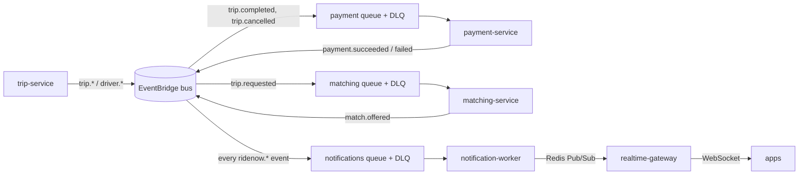

# RideNow Architecture

How RideNow is put together, why, and where it falls short of production.

- Product scope and goals: `RideNow_Project_Proposal.md`.
- Per-service details (ports, APIs, packages): `SERVICES.md`.
- Glossary of techniques: `KNOWLEDGE.md`.
- Persistent fields: `database/ridenow.dbml`.

---

## 1. The guiding idea

> Keep the boundaries fixed. Change only the mechanism behind each boundary.

A boundary is any place where one part of the system talks to another. Every boundary
started with the simplest local mechanism and is swapped for the managed one by
**configuration**, not by rewriting business code:

| Boundary | Local mechanism | Cloud mechanism | Hidden behind |
|---|---|---|---|
| Service-to-service call | HTTP to `localhost` / compose DNS | HTTP to Kubernetes Service DNS | a URL in config + a small client class |
| Domain events | EventBridge + SQS on LocalStack | Amazon EventBridge + SQS | `DomainEventPublisher` (logging impl or EventBridge impl) |
| Durable data | Postgres container per service | RDS PostgreSQL per service | datasource URL |
| Live driver state, GEO, Pub/Sub, cache | Redis container | ElastiCache | Redis host/port (+ TLS flag) |
| Nearby-driver search | Postgres scan | Redis GEO | `NearbyDriverFinder` |
| Payment provider | `SimulatedPaymentGateway` | a real provider | `PaymentGateway` |
| Delivery to apps | logging sender | Redis -> realtime-gateway -> WebSocket | `NotificationSender`, `ClientChannel` |
| Running a service | `mvnw spring-boot:run`, then Docker Compose | EKS on Fargate | image + env vars |
| Secrets | `application.yaml` / `.env` | Secrets Manager via External Secrets + IRSA | env vars |

Test for a healthy boundary: if swapping its mechanism would force a change to business
logic, the boundary has leaked. Fix that before adding anything new.

---

## 2. Services and data ownership

```
                 Rider app                           Driver app
                    |  REST                              |  REST
                    v                                    v
   +--------------+      +--------------+      +----------------+
   | user-service |<-----| driver-svc   |----->| matching-svc   |
   | accounts     | HTTP | drivers,     |handoff| offers,        |
   +--------------+      | live state   |      | Redis GEO      |
                         +--------------+      +----------------+
                    REST                            ^ trip.requested
                    v                               | (SQS)
   +-------------------------------+   HTTP   +----------------+
   |        trip-service           |--------->| payment-svc    |
   | lifecycle, @Version accept    | authorize| hold/capture/  |
   +-------------------------------+          | release        |
                    | events                  +----------------+
                    v                                ^ trip.completed /
             EventBridge bus  --> one SQS queue per consumer --+ trip.cancelled
                    |
                    v
   +-------------------------+  Redis Pub/Sub  +------------------+
   | notification-worker     |---------------->| realtime-gateway |--WebSocket--> apps
   | idempotent SQS consumer |                 | holds sockets    |
   +-------------------------+                 +------------------+
```

| Service | Owns | Talks to others by |
|---|---|---|
| user-service | users | serves HTTP |
| driver-service | drivers, vehicles; live state in Redis | HTTP to user-service; position handoff to matching-service |
| trip-service | trips, trip offers, the accept race | HTTP to payment-service; publishes events |
| payment-service | payments | serves HTTP; consumes its queue; publishes events |
| matching-service | driver positions, offers it makes, the GEO index | consumes its queue; publishes events |
| notification-worker | the processed-notification ledger | consumes its queue; publishes to Redis |
| realtime-gateway | nothing (no database) | subscribes to Redis; holds WebSockets |

Rules that hold everywhere (from `AGENTS.md`):

- **Database per service.** No shared tables, no cross-service joins.
- **Access goes through an API or an event,** never through another service's database.
- **Foreign ids are plain UUIDs,** never JPA relationships across services.
- **Ratings ownership is undecided.** No service owns ratings yet.

---

## 3. Sync or async: the rule and the map

**Rule:** if the caller needs the answer to continue, call it synchronously over HTTP.
If something merely *happened* and others react later, publish an event. Most
interactions stay synchronous, and async is added per interaction, not project-wide.

| Interaction | Mode | Why |
|---|---|---|
| User / driver CRUD; driver -> user validation | Sync | the caller needs the result |
| `POST /trips` -> payment **authorize** | **Sync, strict** | a bad card must stop the trip before any driver is bothered |
| `POST /trips` -> find drivers | **Async** (`trip.requested`) | trip creation must not wait on the geo search |
| `accept` | Sync, then event | the optimistic lock needs an immediate winner or loser |
| `arrive`, `start`, `complete`, `cancel` | Sync, then event | the state change is the answer; reactions come later |
| Trip ends -> payment **capture / release** | **Async** (`trip.completed` / `trip.cancelled`) | the rider never waits on it; retries are safe |
| Any event -> tell the user | **Async** | delivery must never slow the business flow |
| Driver location write | Sync write + Redis Pub/Sub | Redis is the primary store; the stream may lose updates |
| Trip / payment reads | Sync | the caller needs the answer |

### 3.1 Event routing



- **One rule per consumer, matched on `detail-type`.** A consumer sees only the events
  it handles. Adding a consumer means adding a rule and a queue; publishers do not change.
- **Every queue has a DLQ** with `maxReceiveCount` 5. Each queue's policy admits only its
  own rule (`aws:SourceArn`).
- **Events are published after commit** (`@TransactionalEventListener(AFTER_COMMIT)`),
  so a rolled-back change publishes nothing.
- **Every consumer is idempotent,** because SQS delivers at least once. A consumer deletes
  a message only after handling it. A malformed message is dropped, and anything else
  that fails is retried and then dead-lettered.

| Event | Published by | Consumed by |
|---|---|---|
| `trip.requested` | trip-service | matching, notifications |
| `driver.accepted`, `driver.arrived`, `trip.started` | trip-service | notifications |
| `trip.completed`, `trip.cancelled` | trip-service | payment, notifications |
| `match.offered` | matching-service | notifications (to the driver) |
| `payment.succeeded`, `payment.failed` | payment-service | notifications |

### 3.2 Payment: authorize, then capture or release

```
PENDING -> PROCESSING -> AUTHORIZED     sync, inside POST /trips
AUTHORIZED -> PAID                      async, on trip.completed (final fare)
AUTHORIZED -> RELEASED                  async, on trip.cancelled
PROCESSING -> FAILED                    authorize declined
AUTHORIZED -> FAILED                    capture failed (compensation path)
```

- **Strict.** If authorize is declined, trip creation returns `402`. If payment-service is
  slow or down, it returns `503`. Either way no trip row is written.
- **No double hold.** The trip id is the idempotency key, so a retried `POST /trips` cannot
  create a second hold.
- **Compensation.** If the hold may exist but the trip was not saved, trip-service
  publishes a compensating `trip.cancelled`, and payment-service releases the hold. This
  event names no recipient, because the rider already got the error synchronously.
- **Repeats are safe.** Capture and release do nothing on a payment that is already final,
  so a duplicate delivery cannot double-charge.
- **Fare.** trip-service estimates it from straight-line distance times a per-ride-type
  rate plus a base fare. The final fare equals the estimate for now; recomputing it
  from the real route is deferred.
- **Saga case.** A failed capture moves the payment to `FAILED`, publishes
  `payment.failed`, and the rider is notified. There is no cross-service transaction.

### 3.3 Concurrency: exactly one driver wins

- **Where the race lives.** Accept-ride is decided in one service and one database:
  trip-service, with `@Version` optimistic locking. matching-service only proposes
  candidates and never decides who wins.
- **The guarantee.** 50 simultaneous accepts produce exactly one winner, proven by
  `AcceptTripConcurrencyTest`.
- **What's never cached.** Trip status and the accept read. A stale read there would break
  the guarantee.

---

## 4. Messaging and Redis: one job per tool

| Need | Tool | Not this |
|---|---|---|
| Answer now | HTTP | a queue |
| Do one task later, reliably | SQS (+ DLQ) | Redis Pub/Sub |
| One event, many independent reactors | EventBridge -> one SQS queue per consumer | SNS (an alternative to EventBridge; we picked one) |
| Real-time, lossy, latest-value-wins stream | Redis Pub/Sub | SQS |

**Redis Pub/Sub is not a queue.** It is fire-and-forget: a subscriber that is down
misses the message forever, and nothing is stored, retried or dead-lettered. That suits
GPS pings and the last hop to the WebSocket gateway, because the client resyncs over
REST. It never suits payments or anything that must not be lost.

**Redis has four roles,** and caching is the smallest:

1. **Primary store for live driver state** (availability and position, with a TTL). Kept
   out of Postgres on purpose. Losing it is fine, because the app re-reports.
2. **GEO index** for nearby-driver search, owned by matching-service.
3. **Pub/Sub** for driver location and for notifications on their way to the gateway.
4. **Cache-aside** on the driver profile only.

**Cache a read only when all three hold:**

- it is read far more often than it changes;
- it tolerates staleness for the TTL;
- it is a measured hot path.

Default: no cache.

---

## 5. Real-time delivery

- **realtime-gateway only holds sockets.** It has no database and no business logic.
  Clients connect to `/ws` (STOMP) and subscribe to `/topic/users/{userId}`.
- **No sticky sessions needed.** notification-worker publishes each notification on the
  Redis channel `ridenow.notifications`. Every gateway pod subscribes, and the pod that
  holds the recipient's socket delivers it.
- **The socket is an optimization, never the source of truth.** On every connect and
  reconnect the client first fetches current state over REST. Each message carries
  `eventId` and `occurredAt`, so clients drop duplicates and stale messages.
- **Clients only receive.** `SEND` is rejected, and so is a subscription to anything but an
  exact per-user topic. That blocks wildcards that would leak other users'
  notifications. Frame size, subscriptions per connection and frames per window are capped.
- **Rolling deploys.** Shutdown closes sockets with `1001` "reconnect". Clients reconnect
  with exponential backoff, jitter and a connect timeout. `realtime-gateway/README.md`
  has the full client contract.
- **Scope today: notifications only.** Live driver location over the same socket is a
  later task, and the Redis channel for it already exists.

**Why WebSocket and not UDP, WebRTC or QUIC:**

- The traffic is small and low-rate: about one GPS ping a second, and a few events per trip.
- TCP head-of-line blocking does not matter at that rate.
- WebRTC is for peer-to-peer media, and riders and drivers never talk directly.
- WebTransport / QUIC client and server support is still immature.
- Revisit only if load tests show head-of-line blocking on bad mobile networks. SSE is
  the simpler one-way fallback.

---

## 6. Running it

| Stage | How |
|---|---|
| One service | `./mvnw spring-boot:run` + that service's own `docker-compose.yml` (DB only) |
| Whole system | root `docker compose up --build`: 6 Postgres, Redis, LocalStack, 7 services |
| Cloud | EKS on **Fargate** (no node groups), Multi-AZ RDS per service, ElastiCache, SQS, EventBridge |

**Cloud footprint.** CloudFormation in `iac/stacks/`, deployed in order by
`iac/scripts/deploy.sh`. The script resolves the cluster's OIDC id between stacks 06 and 07.

| Stack | Provides |
|---|---|
| 01 | IAM: cluster and Fargate roles, a shared ECR/Secrets policy, one messaging policy per service scoped to its exact queue/bus |
| 02 | three-AZ network with a NAT per AZ |
| 03 | ECR, one repo per service |
| 04 | RDS per service |
| 05 | bus, three queues + DLQs, rules, queue policies, Redis |
| 06 | EKS cluster + Fargate profiles |
| 07 | IRSA roles for the add-ons and for trip, payment, matching and notification-worker |

**What the stacks do not do.** Image builds, Helm add-ons, per-pod security groups and the
`iac/k8s/` manifests are manual steps. Follow `guides/aws/00-deploy-runbook.md`.

**Network posture.**

- RDS and Redis sit in private subnets and admit only cluster traffic. Per-service
  security groups narrow that to "own database only".
- Services are `ClusterIP`. The only internet-facing entry is the ALB: four API paths
  plus `/ws`, with a 300s idle timeout for sockets.

---

## 7. Production readiness

Judged as a **local-first learning project**, the design is sound:

- correct boundaries;
- real swap-the-mechanism discipline;
- the hard concurrency problem solved properly.

Judged as an **enterprise system**, it is not there yet. Every gap below can be closed as a
mechanism swap, not a redesign.

### 7.1 What already holds up

- **Clean boundaries.** Database per service, scalar foreign ids, HTTP or events only.
- **Consistent layering.** Every service uses controller -> service -> repository with
  DTOs, constructor injection and one `@RestControllerAdvice`.
- **A proven concurrency guarantee.** Exactly one driver wins the accept race.
- **A safe async pipeline.**
  - Events are published after commit, through a swappable publisher.
  - Each consumer has its own queue and DLQ.
  - Every consumer is idempotent.
  - Repeated payment actions cannot double-charge.
- **Explicit failure states for payment.** A strict sync authorize, plus compensation
  instead of a distributed transaction.
- **Least-privilege IAM.** Each service's IRSA role reaches only its own queue and the bus.
  Each queue accepts only its own rule.
- **Credible platform setup.**
  - Fargate, with probes, requests/limits and HPA.
  - Secrets come from Secrets Manager.
  - Data tiers are private.
  - Readiness and liveness are split on realtime-gateway.

### 7.2 Blockers

1. **No authentication or authorization.**
   - There is no Spring Security, JWT, or service-to-service auth.
   - The WebSocket accepts any user id.
   - Credentials are not hashed.
2. **No edge TLS, WAF, or source restriction.** The ALB is HTTP:80 and open to the internet.
3. **Sync-call resilience is partial.**
   - trip -> payment has connect and read timeouts.
   - driver -> user has none.
   - There is no retry and no circuit breaker anywhere.
4. **No transactional outbox.**
   - If a process dies between commit and the after-commit publish, the event is lost.
   - That matters most for `trip.completed`, which is what triggers the capture.
5. **Thin observability.**
   - There is a health endpoint only.
   - There are no metrics, no tracing, and no correlation ids across HTTP -> EventBridge -> SQS.

### 7.3 Lower-severity gaps

- **Redis TLS.**
  - ElastiCache is provisioned with in-transit TLS.
  - notification-worker and realtime-gateway set `REDIS_SSL=true`.
  - driver-service and matching-service cannot connect over TLS yet.
- **Orphaned holds.** A hold whose compensation is also lost stays forever. The fix is an
  expiry sweep.
- **No durable inbox.** A user who is offline at the moment of delivery misses the
  notification. REST still shows the true state.
- **No push to closed apps.** A WebSocket reaches only foreground apps, and FCM/APNs are
  out of scope.
- **Probes and HPA.**
  - Most services point both liveness and readiness at `/actuator/health`.
  - realtime-gateway scales on CPU, not on connection count.
- **No east-west restriction between pods.**
  - On Fargate, NetworkPolicy is not enforced.
  - The fix is to extend the per-service security groups to name allowed callers.
- **Cluster policies.** There is no `PodDisruptionBudget` and no resource quota.
- **Queue-depth scaling.** notification-worker and the other consumers don't scale on queue depth.
- **Malformed JSON.** trip-service and matching-service return `500` instead of `400`.
- **Simulated payment.** Payment uses a simulated gateway.

**Hardening order:** security -> observability -> sync-call resilience -> outbox.

---

## 8. How it was verified

The changes were checked against the full local stack (`docker compose up --build`, all
containers healthy) with real STOMP clients subscribed as the passenger and the driver.

| Check | Result |
|---|---|
| Request a trip | `201`; fare computed; payment `AUTHORIZED`, idempotency key = trip id |
| Async matching | `trip.requested` -> offer recorded for the nearby driver; `/match` never called |
| Full lifecycle | the passenger got all six notifications in order, ending with `payment.succeeded` |
| Async capture | `trip.completed` -> payment `PAID`, with no HTTP call |
| Cancel | payment `RELEASED`; `match.offered` reached only the driver |
| Strict authorize | payment-service stopped -> `503`, no trip, no notification |
| Consumer down | the message waited in its queue and was handled on restart |
| Duplicate delivery | the paid payment stayed unchanged |
| DLQ | a malformed message failed 5 times, then sat in the DLQ |
| Gateway restart | socket closed with `1001`; the client reconnected and kept receiving |

**Not verified:**

- **AWS itself.** The stacks pass `cfn-lint`; nothing was deployed.
- **Testcontainers suites.** They could not reach Docker Engine 29 on the dev machine.
- **Scale.** No load tests and no many-replica runs.
