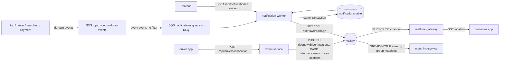
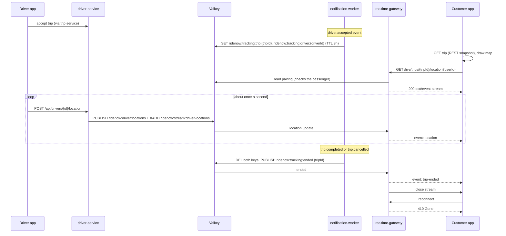

# RideNow Real-time Design

Status: built and verified on the local stack (see `ARCHITECTURE.md` section 8).

Two separate paths carry live data to the apps:

- **Notifications** are stored in an inbox table and read by the frontend through polling. Nothing is pushed.
- **Driver location** streams to the trip's passenger over SSE, only while the trip is active.

The cache behind both paths is ElastiCache for Valkey (Redis protocol, run as a Valkey container locally). The Redis client code, keys and `REDIS_*` variables are unchanged.

Authentication is out of scope for now. Both paths trust the `userId` the client sends. This is a documented gap.

---
## 1. Flow

- notification-worker handles each event once. The inbox row and the processed-event ledger row are written in one transaction.
- On `driver.accepted`, notification-worker also writes the pairing keys that tell the gateway who may watch whom (section 2).
- The driver keeps posting over plain HTTP. Only the customer opens a long-lived connection.
- matching-service reads the same updates from a Redis Stream (`ridenow:stream:driver-locations`) through the consumer group `matching`, to fill its GEO index. Unlike Pub/Sub, an entry stays in the stream until a pod acknowledges it, so a restarted matching pod catches up and a failed update is retried (section 4a).
- The gateway stays on Pub/Sub: it needs every message on every pod, and a missed position is replaced by the next one.

---
## 2. Live location sequence

Response codes on open:

| Code | Meaning | Client action |
|---|---|---|
| 200 | Stream open | Read events |
| 400 | `tripId` or `userId` is not a UUID | Stop; do not retry |
| 403 | `userId` is not this trip's passenger | Stop; do not retry |
| 410 | No pairing: the trip has not started tracking, or it ended | Stop; do not retry |

---
## 3. Stream lifetime by trip status

| Trip status | Stream | Notes |
|---|---|---|
| `REQUESTED`, `SEARCHING` | Not open | No driver yet. The customer polls the trip over REST |
| `DRIVER_ASSIGNED` | Open | Pairing exists from `driver.accepted` |
| `DRIVER_ARRIVED` | Open | |
| `IN_PROGRESS` | Open | |
| `COMPLETED`, `CANCELLED` | Closed | Pairing deleted; `trip-ended` sent; reconnect gets 410 |

If the gateway restarts, the client reconnects while the trip is still in a tracking status. The pairing keys live in Redis, so the stream resumes. The 3h TTL is a safety net for trips that never send an end event.

---
## 4. Redis keys and channels

| Name | Type | Written by | Read by | TTL |
|---|---|---|---|---|
| `ridenow:driver:live:{driverId}` | hash | driver-service | driver-service (`GET .../live`) | 5m |
| `ridenow:driver:track:{driverId}` | sorted set | driver-service | nothing yet | 5m |
| `ridenow:tracking:trip:{tripId}` | string (JSON) | notification-worker | realtime-gateway | 3h |
| `ridenow:tracking:driver:{driverId}` | string (JSON) | notification-worker | realtime-gateway | 3h |
| `ridenow:driver:locations` | pub/sub channel | driver-service | realtime-gateway | none |
| `ridenow:stream:driver-locations` | stream (group `matching`) | driver-service | matching-service | capped, about 10,000 entries |
| `ridenow:stream:driver-locations-dlq` | stream | matching-service | nobody (inspect by hand) | capped, about 1,000 entries |
| `ridenow:matching:offline:{driverId}` | string (epoch millis) | matching-service | matching-service | 10m |
| `ridenow:tracking:ended` | pub/sub channel | notification-worker | realtime-gateway | none |

Payloads:

| Name | Fields |
|---|---|
| `ridenow:tracking:trip:{tripId}` | `passengerId`, `driverId` |
| `ridenow:tracking:driver:{driverId}` | `tripId`, `passengerId` |
| `ridenow:driver:locations` and `ridenow:stream:driver-locations` | `driverId`, `lat`, `lng`, `recordedAt`, `vehicleType` (the vehicle the driver went online with: the one picked with `vehicleId`, else the newest active one), `online` (false on going offline, with no `lat`/`lng`). In the stream, the same JSON is the single field `payload` of each entry |
| `ridenow:tracking:ended` | `tripId` |
| `ridenow:driver:track:{driverId}` | member `lat,lng,epochMillis`, score `epochMillis`. Read oldest first with `ZRANGE`. The timestamp in the member keeps two updates from the same spot as two points |

The track holds the last 5 minutes of a driver's positions. Every location write adds a point and trims the ones older than 5 minutes, and the key expires 5 minutes after the last write. Going offline deletes it. It is stored only: no endpoint or service reads it yet, so reconnect replay, a trail on the map and refresh-safe road snapping are not built. Memory is about 600 points (roughly 30 KB) per driver at one update a second.

Pub/Sub is lossy. That is acceptable for the gateway: the latest position wins, and the next update arrives about a second later. Matching cannot afford to miss updates while a pod restarts, which is why it reads the stream instead. Fields are additive, and readers ignore unknown fields.

---
## 4a. Driver-location stream (matching-service)

driver-service appends every update to `ridenow:stream:driver-locations` (`XADD ... MAXLEN ~ 10000`) as well as publishing it on the channel. The two writes are independent: if one fails, the other and the location write still happen. The cap suits a small deployment (50 to 100 drivers posting about once a second is 50 to 100 entries a second, so about 100 to 200 seconds of history, around 2.5 MB). Set `RIDENOW_LOCATION_STREAM_MAX_LENGTH` to change it.

matching-service reads the stream through the consumer group `matching` (`XREADGROUP`, up to 100 entries per read, blocking 2s). The consumer name is the pod hostname.

| Situation | What happens |
|---|---|
| Normal | The entry is applied, then acknowledged (`XACK`) |
| Matching pod is down or restarting | Entries wait in the stream. The pod reads them when it is back, as long as they have not been trimmed |
| Handler fails (database or cache error) | The entry is not acknowledged. After 30s idle, a reclaimer on any live pod takes it over and runs it again |
| Pod dies mid-batch | Same: its pending entries are reclaimed by another pod after 30s |
| 5 deliveries without success | The entry is copied to `ridenow:stream:driver-locations-dlq` (capped) and acknowledged |
| Malformed entry | Logged, dropped and acknowledged, so it is not retried |

Delivery is at-least-once, so the same entry can arrive twice and entries can arrive out of order. matching-service therefore compares each report's `recordedAt` with the stored one and ignores anything that is not newer. When a driver goes offline it also writes `ridenow:matching:offline:{driverId}` (10 minute TTL), so a late position recorded before that moment cannot bring the driver back.

The group is created at the beginning of the stream on first start, so entries driver-service wrote before matching first started are applied rather than skipped (replaying them is safe because older reports are ignored). Deploy driver-service first (it writes the stream), then matching-service. While matching is down, entries older than the cap are lost, but the next position from each driver repairs the index.

---
## 5. SSE client contract

Endpoint: `GET /live/trips/{tripId}/location?userId={passengerId}`, `Accept: text/event-stream`.

1. Open the stream only while the trip is in a tracking status (section 3).
2. Fetch the REST snapshot first (trip, and `GET /api/drivers/{id}/live`), and draw it. The stream only adds updates.
3. Then create the `EventSource`.
4. Handle two events:

| Event | Data | Client action |
|---|---|---|
| `location` | `{driverId, tripId, lat, lng, recordedAt}`, with no `id` | Feed the smooth marker |
| `trip-ended` | `{tripId}` | Close the `EventSource`, refetch the trip over REST |

5. 400, 403 and 410 stop retries. The browser's `EventSource` does not expose the status code, but per the spec a non-200 response closes it for good: `error` fires with `readyState === CLOSED`. The client then stops and checks the trip over REST. An `error` with `readyState === CONNECTING` is a dropped connection that the browser is already retrying.
6. The server sends `: ping` comments every 15s. Use them to notice a dead connection. The server also sets a jittered `retry:` so reconnects do not arrive together.
7. Close the stream on a terminal status or when the component unmounts.

Server limits: at most 3 streams per trip per pod, a 30-minute timeout per stream (the client reconnects), and at most one `location` event per second per trip. Responses carry `Cache-Control: no-cache` and `X-Accel-Buffering: no`. On shutdown the gateway completes every stream, and clients reconnect.

---
## 6. Smooth marker guidance

Positions arrive about once a second with network jitter. Jumping the marker to each one looks choppy. The client renders slightly in the past and interpolates.

- **Buffer and delay.** Keep a short buffer of points. Render about 1s behind the newest, and interpolate between the two surrounding points with `requestAnimationFrame`.
- **Order.** Sort by `recordedAt`. Drop any point older than the last one applied.
- **Jumps.** If a move is longer than 500 m, set the marker there directly with no animation (for example, after a long reconnect gap).
- **Stale.** If no point arrives for 10s, mark the car as stale (grey it out or show "last seen"). Clear it on the next point.
- **Heading.** Compute the bearing between points. Ease toward it, turning the shortest way around (for example, 350° to 10° is +20°, not -340°).
- **Panning.** Pan the map only when the marker nears the edge of the view, not on every point.
- **Clock offset.** `recordedAt` is driver-service's clock, stamped when it stored the position. The customer device's clock can differ by seconds. Order and interpolate by `recordedAt` differences, and do not compare it with the client's `Date.now()`. Use arrival time for the stale check.

---
## 7. Road snapping

GPS points drift off the road. The frontend can snap them with OSRM, behind a `RoadSnapper` interface (`NoopSnapper`, `OsrmSnapper`). `VITE_OSRM_URL` selects it. Empty means off.

| Use | OSRM service | Input | Result |
|---|---|---|---|
| Rider map, real GPS | `match` | Recent points from the stream | Snapped polyline for display |
| Driver "simulate drive" | `route` | Pickup to destination | Road-following list of points the simulator walks along |

Rules:

- **Display only.** Snapped points are never sent back to a service and never stored. The raw GPS position stays the data.
- **Fallback.** On a timeout or error, use the raw points. With `route` off, the simulator uses a straight line.
- **Demo server.** The public OSRM demo server (`router.project-osrm.org`) is for development only. Check its usage policy before relying on it. It has rate limits and no uptime promise.
- **Self-hosting.** Documented, not built. Run `osrm-routed` with an extract for the target region, and point `VITE_OSRM_URL` at it.
- **Production alternative.** Map matching on the server (a consumer of the location channel that snaps and republishes) removes the per-client calls and gives all consumers the same positions. It adds a service and latency, so it is not built.
